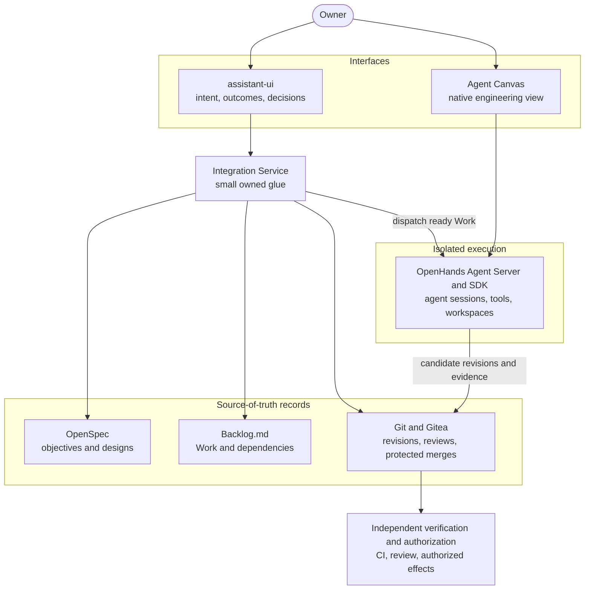

# AI Engineering Harness

AI Engineering Harness is an open-source engineering system that turns an Owner's intent into designed, implemented, reviewed and verified software.

It is adoption-first. It composes established open-source products, integrates them through small, replaceable modules, and builds custom software only where a demonstrated gap remains. The engineering focus is on reproducible, pinned compositions; evidence tied to exact revisions; enforced security boundaries between the Owner's trusted side and untrusted agent execution; and integration that stays maintainable as upstream projects evolve.

The project is under active development. This repository holds a working implementation foundation, not the completed application; see [Current status](#current-status).

## Architecture overview

The design authority is the [architecture blueprint](AI_Engineering_Open_Source_Blueprint_Architecture_Deep_Review_2026-10-31.html). Its [overview](AI_Engineering_Open_Source_Blueprint_Architecture_Deep_Review_2026-10-31.html#overview), [system composition](AI_Engineering_Open_Source_Blueprint_Architecture_Deep_Review_2026-10-31.html#architecture) and [selected software](AI_Engineering_Open_Source_Blueprint_Architecture_Deep_Review_2026-10-31.html#components) sections are the best starting points. In brief:

- **Owner interaction and intent capture.** The Owner states a desired outcome in conversation. assistant-ui provides the Owner workspace for intent, outcomes and decisions. Original intent is kept separate from proposed solutions.
- **Architecture and specification management.** OpenSpec holds versioned objectives, proposals, specifications and designs.
- **Work planning and dependencies.** Backlog.md holds tasks, acceptance criteria, dependencies and readiness.
- **Agent orchestration and isolated execution.** The OpenHands Software Agent SDK and Agent Server run agent sessions, tools and workspaces in a contained, low-privilege environment with no access to Owner secrets or host management. Agent Canvas is the native engineering view (conversation, terminal, files, activity) and connects directly to the Agent Server. Coding providers such as Claude Code or Codex are user-supplied and replaceable.
- **Independent verification, governance and authorization.** Implementations are independently challenged and validated at exact revisions. Consequential effects require an Owner-only protected merge and run through a separate, isolated executor. No agent can approve its own effect.
- **Git-backed artifacts, provenance and delivery.** Git and Gitea hold revisions, reviews and decisions. A small local Integration Service links records across these products by stable references instead of copying their state. Delivery counts only when the actual effect is observed, never on an agent's report.



### Component status

**Target architecture.** The components above are the target: the OpenHands Software Agent SDK and Agent Server, Agent Canvas, assistant-ui, OpenSpec, Backlog.md and Gitea are **selected and locked**. Their exact upstream versions are recorded in the [compatibility matrix](composition/compatibility-matrix.md) and pinned by hash, integrity and digest in the [component lock](composition/lock/README.md). Selecting and locking a component means its artifacts are pinned and verified; it does not mean the component is integrated or running in the harness.

**Dulwich, the harness's own Git implementation.** *Target:* the harness's Python components read and write Git repositories in process with Dulwich 1.2.21 ([pinned and hash-locked](composition/lock/README.md)), through one shared module, on Windows, Linux and macOS alike; the Git command line stays only where a documented compatibility gap justifies it, and a launch census test holds that list ([decision 0014](decisions/0014-dulwich-adoption-scope-and-repository-access-contracts.md)). *Verified:* on Windows 11 x86_64, the module's differential contract suite passes against Git's own answers, and the components that use it pass their tests with Git launched only at the retained places. On Linux the contract suite is still to run in the disposable verification guest, a run that needs the Owner's approval; macOS is not yet verified.

**Verified today.** The verified work is foundation work, such as the pinned composition and the resolver that checks it, repository tooling and integrity checks, managed execution guests for a reference execution profile, local operational stores tested on fixtures, and the first product artifacts in [`catalog/`](catalog/). This README does not list each verified item. The records under [Current status](#current-status) give each verdict with its scope and limits. Treat a component or capability as integrated or operational only when one of those records says so.

## Current status

The project is in its bootstrap phase. It is building the foundation the harness will run on and verifying each part with recorded evidence. No part of it is ready for production use. The strong isolation tier for agent execution is operational for one execution profile, QEMU with WHPX on Windows, and only on the host it was qualified on: the Overseer declared it operational on 2026-11-09 under the profile contract's isolation condition (C6). A new host, a changed pin or a change to the guest requalifies the profile. No agent run is dispatched to it yet: dispatch still needs an approved catalog pin, and the dispatcher does not exist yet. The other execution profiles and providers, including Linux and macOS, are not yet verified.

This README does not track progress. The authoritative records are:

- **Verdict history:** the [bootstrap log](evidence/bootstrap-log.md) records each verdict during bootstrap, with its revision and evidence. Once Backlog.md is adopted as the Work system, Backlog.md replaces it as the record of progress.
- **Decisions:** accepted and proposed decision records are in [`decisions/`](decisions/).
- **Evidence and qualification:** the detailed evidence behind each verdict, including its limits, is in [`evidence/`](evidence/) and in the `QUALIFICATION.md` of each qualified execution profile under [`profiles/`](profiles/).

The [plan](AI_Engineering_Implementation_Project_Plan_Overseer_Prompts_2026-10-31.json) defines the work; its own status fields are its original baseline, not progress.

## Getting started

Let a coding agent set the repository up for you, then describe the change you want.

1. Install Git and CPython 3.12 or newer.
2. Clone the full repository: `git clone https://github.com/rschuft/ai-engineering-harness`.
3. Install Claude Code or Codex by its official instructions, and open the cloned folder with it.
4. Give it this setup instruction:

   > Set up this repository on my machine. Read AGENTS.md first, then follow the Quick start in docs/development.md: check the basic prerequisites, verify the repository, install the hash-locked tools set and run the tests, and install the publication-safety gate. Before any step that downloads something or changes anything outside this folder, tell me what it will do and wait for my answer. Do not change my user-level settings, agents or skills, and do not start any project work. Finish by reporting each command you ran and its result, what was installed and where, how to remove it, and what you could not verify.

5. Describe the change you want. The agent discovers the project's tooling, implements and verifies the change, and you review the result. [`CONTRIBUTING.md`](CONTRIBUTING.md) walks through this.

Coding agents follow [`AGENTS.md`](AGENTS.md) (Claude Code reads it through [`CLAUDE.md`](CLAUDE.md)); the setup needs nothing else installed first. It prepares the repository for ordinary contribution. It does not install the five development roles described in [How work is done here](#how-work-is-done-here): installing them from a fresh clone is planned and **not yet verified**.

[`docs/development.md`](docs/development.md) is the technical reference: prerequisites, verified platforms, every developer command and its direct equivalent, and how to change integrity-tracked files.

## How work is done here

Three different workflows touch this repository:

1. **Ordinary contribution.** A developer clones the repository, opens a capable coding agent, and describes the change they want. One coding agent is enough; see [`CONTRIBUTING.md`](CONTRIBUTING.md). Agent instructions are in [`AGENTS.md`](AGENTS.md) and [`CLAUDE.md`](CLAUDE.md).
2. **The current implementation arrangement.** The Owner is carrying out the initial implementation plan through five agent roles. A product manager leads planning: it refines the Owner's intent, sets priorities and selects milestones, and invokes a program manager for dependencies, sequencing and readiness. An engineering manager (the Overseer) leads execution against those commitments and delegates bounded tasks, one per dispatch, to an engineer (the Builder). Either lead consults one shared architect when a design question warrants it. These agents are defined in the Owner's own environment; they are not part of this repository and are not prerequisites for contributing. Their operating resources are temporary:
   - [`OVERSEER_START.md`](OVERSEER_START.md): Overseer startup, delegation, continuation and recovery instructions.
   - [`task_prompts/`](task_prompts/): one scoped implementation prompt per plan task, indexed by [`task_manifest.json`](task_manifest.json). They are used through Overseer coordination, which handles dependencies and parent acceptance. They are not a batch execution script, but they do support targeted execution and recovery of an individual task.
3. **Future native orchestration.** The completed AI Engineering Harness will provide its own engineering orchestration and execution (see [Architecture overview](#architecture-overview)). It will not depend on these temporary, Claude-specific roles.

## Repository guide

| Looking for | Go to |
|---|---|
| Architecture | [Blueprint](AI_Engineering_Open_Source_Blueprint_Architecture_Deep_Review_2026-10-31.html) |
| The plan | [Canonical JSON](AI_Engineering_Implementation_Project_Plan_Overseer_Prompts_2026-10-31.json), with an [HTML view](AI_Engineering_Implementation_Project_Plan_Overseer_Prompts_2026-10-31.html#roadmap) and a [CSV view](AI_Engineering_Implementation_Work_Packages_Small_Steps_2026-10-31.csv) |
| How to contribute | [`CONTRIBUTING.md`](CONTRIBUTING.md) |
| Developer setup and commands | [`docs/development.md`](docs/development.md), [`Taskfile.yml`](Taskfile.yml) |
| Implementation evidence | [`evidence/`](evidence/) |
| Decisions | [`decisions/`](decisions/) |
| Component selection, locks and licence inventory | [`composition/`](composition/) |
| Trust domains, principals, protected assets and credential requirements | [`security/`](security/) |
| Role-token matrix and revocation contract | [`policy/`](policy/) |
| Coding agent instructions | [`AGENTS.md`](AGENTS.md), [`CLAUDE.md`](CLAUDE.md) |
| The Owner's current implementation arrangement | [`OVERSEER_START.md`](OVERSEER_START.md), [`task_prompts/`](task_prompts/); see [How work is done here](#how-work-is-done-here) |

The blueprint, plan and task prompts are integrity-tracked; [`docs/development.md`](docs/development.md#changing-integrity-tracked-files) explains how to change them.

## Provenance

The repository was bootstrapped from a seed that was imported at commit `13197dd` ([bootstrap entry](evidence/bootstrap-log.md#bootstrap)). The original import can still be verified strictly from git history, in a full clone:

```
python -I tools/verify_seed.py --baseline seed
```

## Scope and licence

- AI Engineering Harness is a standalone open-source project.
- Repository-authored code and documentation are licensed under the [MIT License](LICENSE).
- Third-party dependencies are downloaded from their upstream distributors onto the user's machine, pinned and hash-verified; this project does not redistribute them ([decision 0005](decisions/0005-distribution-model-upstream-download-no-redistribution.md)).
- Third-party components and artifacts keep their own licences and distribution obligations. Licence compliance of the composition is not yet verified; open items are tracked in the [licence ledger](composition/inventory/LEDGER.md). What this repository itself publishes is covered by the [publication audit](composition/inventory/PUBLICATION-AUDIT.md).
